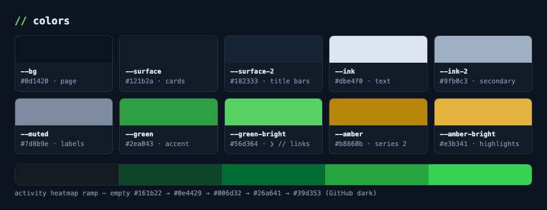
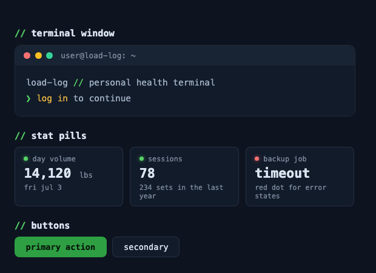
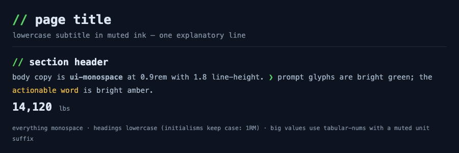
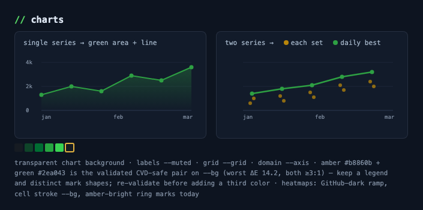

# style-terminal-navy

The readablecode "terminal navy" house design system: navy terminal surfaces,
monospace type everywhere, a green prompt accent, amber highlights, and
`// section` headers. It is shared by the readablecode portfolio site
(site.tinkernet.me), [load-log](https://github.com/ReadableCode/load-log), and
future projects.

It exists so every project gets the same look without re-deciding colors,
type and chart palettes each time, and so coding agents can apply that look on
their own. There is no build step and no package: it is a written spec, a CSS
token file, a Claude Code skill wrapper, and static HTML previews.

## What is in it

| File | Purpose |
|---|---|
| `STYLE.md` | The full spec and source of truth: tokens, typography, component patterns, chart rules (including the CVD-validated two-series palette). |
| `tokens.css` | The same values as CSS custom properties (`--bg`, `--surface`, `--green`, `--amber`, heatmap ramp, radii, `--font-mono`), ready to copy into a project. |
| `SKILL.md` | Claude Code skill wrapper (`terminal-navy`). Drop this directory into a skills folder to have agents apply the style automatically. |
| `previews/*.html` | Self-contained reference renderings (colors, type, components, charts). Open in a browser when unsure how a piece should look. |

## The style in brief

`STYLE.md` has the full detail; the core rules are:

- Navy surfaces: page `#0d1420`, cards `#121b2a`, raised title bars
  `#182333`, 1px hairline borders `rgba(148, 163, 184, 0.16)`, 8px radius
  (10px for terminal windows), no shadows.
- Monospace type everywhere, lowercase headings and labels (initialisms keep
  their case), tabular numbers for aligned values.
- Green is the accent (`#2ea043` fills, `#56d364` for the `❯` prompt, `//`
  and links); amber (`#b8860b` / `#e3b341`) is the highlight.
- Signature components: `//` section headers, the `❯ app-name` prompt brand,
  stat tiles with a glowing status dot, terminal windows with three title-bar
  dots, solid green primary buttons.
- Charts: single series in green, two series in amber plus green (a pair
  checked for colorblind safety on the page background), GitHub-dark green
  ramp for activity heatmaps.

## Using it in a project

Copy `tokens.css` into the project, then paste the summary block from the
"Applying this in a new project" section of `STYLE.md` into the project's
CLAUDE.md so agents keep new UI on-style.

To have Claude Code apply the style without being told, place this directory
in a skills folder; `SKILL.md` points the agent at `STYLE.md`, `tokens.css`
and the previews.

To view the previews, open any file in `previews/` directly in a browser. They
need no server or network access.

A live reference implementation (Streamlit + Altair) is
`backend/src/web/app.py` with `backend/.streamlit/config.toml` in the load-log
repo.
